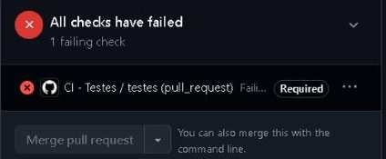

# Futebol por Região

Aplicação web que mostra o estado e a região do Brasil de clubes de futebol brasileiros e permite salvar times favoritos num banco de dados.

## Integrantes

| Nome | Matrícula (RA) | Usuário GitHub | Funcionalidades | Principal PR |
|---|---|---|---|---|
| Gustavo Rodrigues Sousa Spindola | 22654035 | [@gust4vorss](https://github.com/gust4vorss) | Todas: frontend, integração com a API do IBGE, persistência (Supabase), testes, CI e Docker | [PR #1](https://github.com/gust4vorss/bootcamp2-appTimes/pull/1) |

> Projeto feito individualmente (grupo de 1 integrante).

## Links

- Repositório: https://github.com/gust4vorss/bootcamp2-appTimes
- Aplicação no ar: https://gust4vorss.github.io/bootcamp2-appTimes/
- Docker Hub: https://hub.docker.com/r/gust4vorss/bootcamp2-app

## Descrição

- **O que faz:** busca um time pelo nome e mostra estado, região e código IBGE; lista os estados de cada região com seus times; salva, lista e exclui times favoritos.
- **API externa:** [API de Localidades do IBGE](https://servicodados.ibge.gov.br/api/docs/localidades)
  - `GET /api/v1/localidades/estados/{UF}` — dados do estado e sua região
  - `GET /api/v1/localidades/regioes/{id}/estados` — estados de uma região
- **Banco de dados:** Supabase (PostgreSQL), tabela `favoritos` (script em `banco.sql`):

| Coluna | Tipo | Para que serve |
|---|---|---|
| id | bigint (automático) | Identificador |
| criado_em | timestamptz (automático) | Data em que foi salvo |
| nome_item | text (único) | Nome do time |
| dados_extra | text | Estado e região, ex.: "São Paulo (SP) · Sudeste" |

CRUD: criar (⭐ Favoritar), listar (Meus favoritos) e excluir (Excluir).

## Como executar

**Com Docker (um comando):**

```bash
docker run -d -p 8080:80 gust4vorss/bootcamp2-app:1.2
```

Depois abra http://localhost:8080. Não precisa de variáveis de ambiente.

**Localmente:**

```bash
git clone https://github.com/gust4vorss/bootcamp2-appTimes
```

Abra o `index.html` com a extensão Live Server do VS Code (o site usa `type="module"`, então precisa ser servido, não aberto com duplo clique).

## Testes

As funções centrais ficam em `utils.js` (funções puras) e os testes em `utils.test.js`, usando o executor de testes nativo do Node (`node:test`), sem dependências.

```bash
npm test
```

São 6 testes: normalização de texto, busca de time por nome exato, busca por parte do nome, time inexistente/entrada vazia, times de um estado e formatação do resumo salvo no banco.

O GitHub Actions (`.github/workflows/ci.yml`) roda os testes a cada PR e a cada push na `main`.

## Fluxo de trabalho

- A `main` é protegida: não aceita push direto, só merge por Pull Request com o check **testes** passando.
- Como o projeto foi feito por uma pessoa só, a aprovação obrigatória ficou em 0 (o GitHub não permite aprovar o próprio PR). A revisão foi feita com comentário no próprio PR.
- Branches seguem o padrão `feature/nome-da-funcionalidade`.

| PR | Branch | O que fez |
|---|---|---|
| [#1](https://github.com/gust4vorss/bootcamp2-appTimes/pull/1) | `feature/testes-ci` | Separa funções puras em `utils.js`, adiciona 6 testes e o workflow de CI |
| [#2](https://github.com/gust4vorss/bootcamp2-appTimes/pull/2) | `feature/teste-ci-bloqueio` | Teste quebrado de propósito para provar que o CI bloqueia o merge; corrigido em seguida |

## Evidências

**PR bloqueada pelo CI** (teste quebrado de propósito no PR #2):



**Conflito de merge:** não houve conflito de merge durante o projeto.
